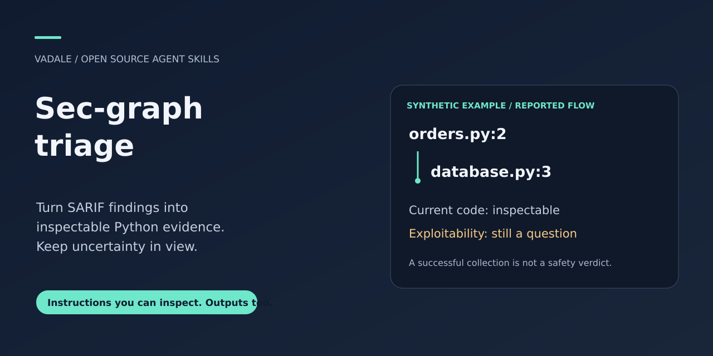
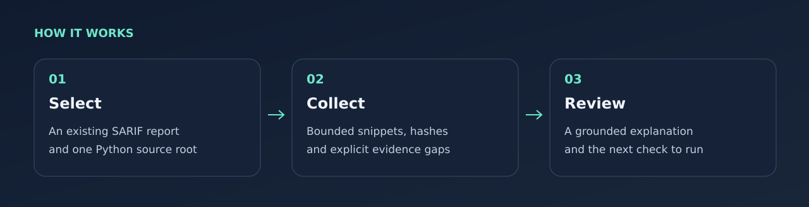

# Sec-graph triage



[](https://github.com/Vadale/sec-graph-triage/actions/workflows/ci.yml)
[MIT](LICENSE) · [Download](https://github.com/Vadale/sec-graph-triage/releases) · [Worked example](examples/triage-walkthrough.md)

**Explain an existing security finding against the code you have now.** An agent
skill plus a small local Python helper for **SARIF 2.1.0 reports and Python
projects**. Give your assistant a report and source directory; get bounded code
evidence, an explanation of what it supports, and concrete checks to perform next.

For developers reviewing scanner output, maintainers revisiting old findings,
and security reviewers who need source references rather than an unsupported
“looks safe.” The helper collects evidence; your host assistant interprets it.

## What you get

| Input or question | Delivered support |
|---|---|
| “Where is the reported path in today's code?” | Selected source windows with file hashes and line references |
| “Did the report match these files?” | Comparisons with report-provided digests/snippets, including mismatches |
| “What evidence is missing?” | Explicit missing steps, unsupported coordinates and collection diagnostics |
| “What should I check next?” | An assistant explanation separating reported claims, current observations and unresolved questions |



It keeps separate reported flows, threads, repeated steps and gaps. Current-source
matching does **not** authenticate a scanner, establish its original scan snapshot,
prove exploitability, infer authentication or certify an application safe. This
skill complements your scanner; it does not run a new scan or the target program.

## Install and ask

In Codex, ask the built-in installer:

```text
$skill-installer install https://github.com/Vadale/sec-graph-triage/tree/main/skills/sec-graph-triage
```

Alternatively, copy the complete [skills/sec-graph-triage](skills/sec-graph-triage)
folder to your assistant's documented skills directory. Codex supports
`~/.agents/skills/` for user skills. Keep its license and linked resources.
Confirm that the skill appears; restart Codex if discovery has not refreshed.
See the [official skill guide](https://developers.openai.com/codex/skills).

Then provide **paths you authorize the assistant to read**:

```text
Use $sec-graph-triage on /path/to/findings.sarif and /path/to/python-project.
Explain the highest-priority findings using current code. Show supporting lines,
distinguish missing evidence from negative evidence, and propose the next check.
Do not modify the project or treat collection as a security verdict.
```

No full sec-graph installation, graph engine, MCP server or API key is required.
The assistant needs local file/command access and a suitable Python runtime.
The helper makes no network calls, but excerpts and tool results can enter your
host assistant's context. Choose an environment authorized for that source code.

## Try the included example

Clone or download the repository and run from its root. Choose a **new** output
outside the source tree:

```sh
python skills/sec-graph-triage/scripts/collect_context.py \
  --root examples/project --sarif examples/findings.sarif \
  --output example-evidence.json
```

The deliberately unsafe, synthetic example reports a path from `orders.py` to a
concatenated query in `database.py`. The helper reads that code without executing
it. The [walkthrough](examples/triage-walkthrough.md) shows a grounded interpretation
and the questions still open. You can inspect the JSON without any model.

Exit **0** means collection complete; **2** means usable but partial evidence;
**1** means failure. Read both receipt and bundle diagnostics. None of these codes
is a vulnerability or safety verdict. Default selection is the first 20 results,
with remaining results counted. Use `--finding RUN:RESULT` for a subset or
`--map /old/root=.` for an explicitly chosen source relocation.

## Scope and checks

POSIX Python with descriptor-relative file operations is required. The code
targets Python 3.11+; local validation used Linux/Python 3.15. The workflow above
runs public tests on Python 3.11 and 3.13; inspect its actual result for this commit.
Other runtimes and platforms require verification.

The helper rejects source symlinks and nonregular files and uses only the chosen
root. This is a static-file read boundary, not an OS sandbox or protection from an
actively hostile process racing filesystem changes. Main limits: 8 MiB input,
200 input results/20 selected, 1 MiB per source file, 16 KiB per window, 2 MiB
evidence. This is a bounded SARIF profile. It does not preserve every upstream
message, raw thread identifier or SARIF feature; consult the original report when
those fields matter. [Full evidence contract](skills/sec-graph-triage/references/evidence.md).

```sh
python -m unittest discover -s tests -v
```

Public checks cover exact current context, digest mismatch, missing steps and
escaping symlinks. They establish declared collection behavior, not vulnerability
accuracy, security completeness, customer validation or measured efficiency.

## Contribute and reuse

[Report a reproducible issue](https://github.com/Vadale/sec-graph-triage/issues)
using a small, sanitized example. [Contribution guidance](CONTRIBUTING.md).
Audit only projects you own or are authorized to review.

Adapted from selected sec-graph normalization/source-window work under MIT;
[provenance](skills/sec-graph-triage/references/provenance.md), [license](LICENSE).
The full analyzer, authentication rules, MCP server and upstream benchmark corpus
are not bundled.

Related: [R Statistical Analysis](https://github.com/Vadale/r-statistical-analysis)
for statistical work; [AI Project Coach](https://github.com/Vadale/ai-project-coach)
for reviewing how you work with AI. Each is independently usable.
